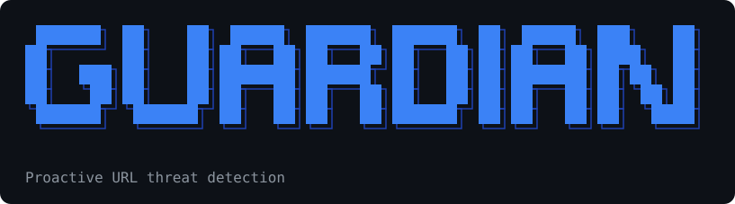

<p align="center"></p>

# Guardian

Proactive URL threat detection. Guardian runs as a local proxy and checks every URL you visit.

**Phase 1:** Layer 1 whitelist. A site in the whitelist database loads normally.

**Phase 2:** anything else is checked against PhishTank, Google Safe Browsing and VirusTotal. Found in any of them: a *Link is malicious* page replaces the site (with *Go back* / *Continue anyway*), showing the chance of being malicious: 33% if 1 of the 3 sources flags it, 66% for 2, 100% for all 3. Found in none: an *Alert: May be malicious* page with *Go back* / *Continue anyway*. The Layer 3 sandbox is not built yet.

## Install

Needs Python 3.9+.

**Windows / macOS**

```
git clone https://github.com/sukritisaraswati/Guardian.git
cd Guardian
pip install .
```

**Kali / Debian / Ubuntu** (plain `pip install` is blocked there with `externally-managed-environment`)

```
sudo apt install pipx libnss3-tools
pipx ensurepath                 # then open a new terminal
git clone https://github.com/sukritisaraswati/Guardian.git
cd Guardian
pipx install .
```

## Use

```
guardian start        # start protecting (sets the OS proxy)
guardian stop         # stop and restore your previous proxy settings
guardian status
```

First time only, so HTTPS sites work through the proxy:

```
guardian install-cert
```

Then restart the browser. Without this step, sites that are **not** whitelisted show a certificate error (`SEC_ERROR_UNKNOWN_ISSUER`) instead of Guardian's warning page. Whitelisted sites always load normally: Guardian passes their HTTPS traffic through without decrypting it.

- Windows: adds the certificate to your user trust store (Windows asks you to confirm) and tells Firefox to trust that store.
- Linux: adds it to every Firefox profile and to Chromium/Chrome (needs `certutil` from `libnss3-tools`). Open Firefox at least once before running it.
- macOS: prints the `security` command to run, and tells Firefox to trust the system store.

On Linux, `guardian start` sets the proxy through GNOME settings only. On other desktops (Kali's default Xfce, KDE), use `guardian start --no-system-proxy` and set the browser's proxy by hand: Firefox > Settings > Network Settings > Manual proxy `127.0.0.1` port `8899`, and tick "Also use this proxy for HTTPS".

Options for `start`: `--port 8899`, `--no-system-proxy` (point the browser at the proxy yourself).

### API keys (Phase 2)

```
guardian set-key virustotal <key>
guardian set-key safebrowsing <key>
guardian set-key phishtank <key>     # optional
```

Or set `VIRUSTOTAL_API_KEY`, `GOOGLE_SAFE_BROWSING_API_KEY`, `PHISHTANK_APP_KEY`. Keys are stored in `~/.guardian/config.json`, outside the repo, so they are never pushed to GitHub. That also means **every machine needs its own `guardian set-key`** after cloning; `guardian status` lists any missing key. A source without a key is skipped, and the warning page says so. Each non-whitelisted page URL is sent to Google and VirusTotal for the lookup.

If Guardian crashes, run `guardian stop` (or `guardian start` again) to restore your proxy settings.

## How a URL is handled

1. Every request goes through the proxy.
2. The host is matched against the whitelist: the exact host, then its parents up to the registrable domain (`mail.google.com` matches `google.com`). Shared-hosting suffixes such as `github.io` and `blogspot.com` are not inherited, so `user.github.io` is not trusted just because `github.io` is.
3. Whitelisted: the site loads normally. Local addresses also pass.
4. Not whitelisted, and the user is opening a page: PhishTank (local copy of its feed, refreshed every 3 hours) is checked first, then Google Safe Browsing and VirusTotal in parallel under a 1.5 s limit (`GUARDIAN_PHASE2_TIMEOUT`). Results are cached. Free VirusTotal keys allow 4 lookups a minute. A source that is slow or unavailable counts as "not found".
5. Not whitelisted, and it is an image/script/etc. loaded by a page: only the local PhishTank feed and cache are used, so pages stay fast.
6. The site is also categorized in the background (never delays the page).

VirusTotal counts as "found" when at least 2 engines flag the URL (`GUARDIAN_VT_MIN=1` for any single engine). Decisions are logged to `~/.guardian/guardian.log`.

## Whitelist data

`guardian/data/whitelist.csv.gz` (`domain,category`) is built from `database.csv` by `tools/build_whitelist.py`. On first start it is loaded into SQLite at `~/.guardian/whitelist.db`. Categories of about 565k entries were not verified (see `categorization_review_report.md`), but matching depends only on the domain.

## Tests

```
pip install pytest
python -m pytest tests
```
